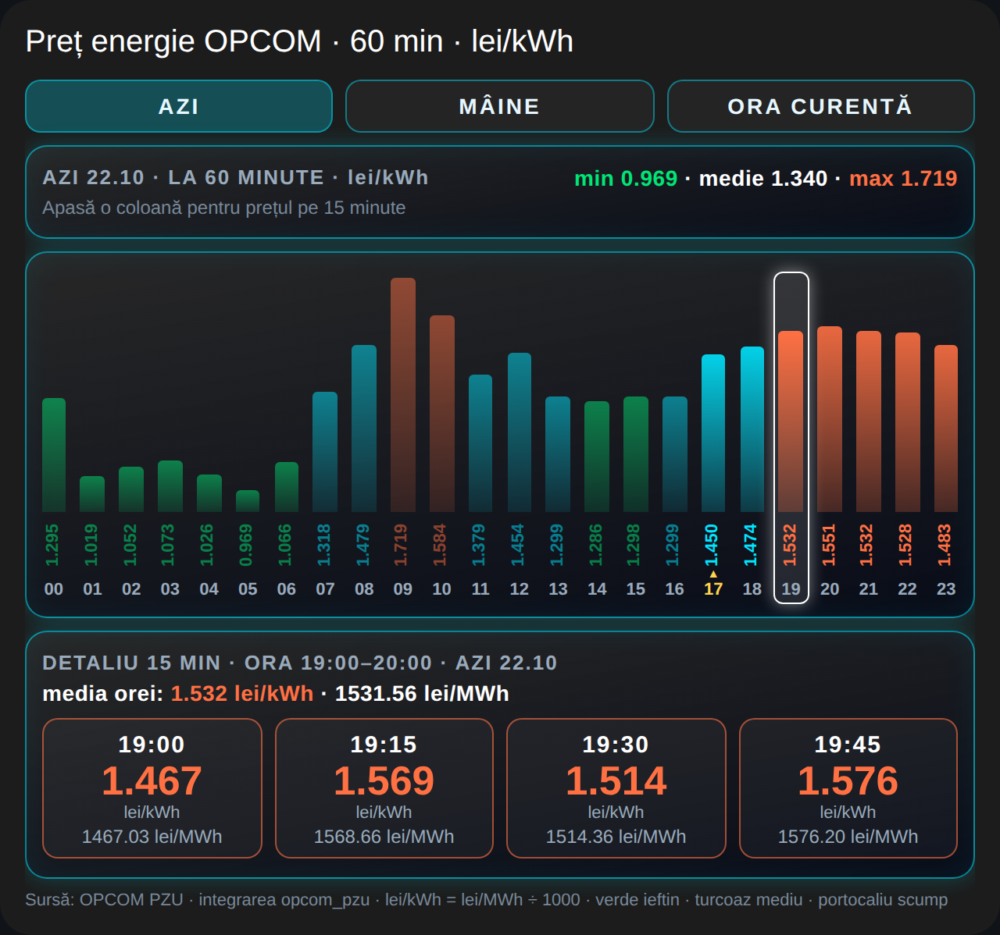

# OPCOM PZU în Home Assistant

Integrare nativă pentru **Home Assistant** (instalabilă din HACS) care aduce prețurile energiei electrice de pe piața pentru ziua următoare (PZU) de la [OPCOM](https://www.opcom.ro): preț curent, minim / maxim / medie, următoarea oră ieftină, prețuri pe 15 / 30 / 60 de minute pentru azi și mâine, plus un card interactiv pentru dashboard. Fără Node-RED, fără MQTT, fără credențiale.



*English, short:* a Home Assistant custom integration (HACS-compatible) that downloads the public OPCOM day-ahead market (PZU) CSV and exposes Romanian electricity prices as sensors (current 15-min price, today/tomorrow min/max/average, next cheap hour, 15/30/60-minute lists as attributes). OPCOM intervals are in CET/CEST and are converted to Romanian local time, including 23/25-hour days. An interactive `custom:button-card` dashboard card (needs `button-card` and `browser_mod`) is included: click for a 60-minute chart popup, click a column for the 15-minute detail. Unofficial, not affiliated with OPCOM. The Node-RED variant moved to [opcom-nodered](https://github.com/FloreaIonut/opcom-nodered).

## Ce face

- descarcă CSV-ul public OPCOM (rezoluție 15 min) și publică senzori în HA;
- **convertește corect ora**: OPCOM raportează în CET/CEST, adică ora României minus 1 h (vezi [Convenția de timp](#convenția-de-timp-cet));
- prețuri pe **15, 30 și 60 de minute**, pentru **azi** și **mâine** (mâine apare după ce publică OPCOM, de obicei în jur de 14:00 ora României);
- **minim / maxim / medie** pe zi și **următoarea oră ieftină** (prima oră care urmează, cu media sub media zilei);
- cache local: după o repornire senzorii au valori chiar dacă OPCOM nu răspunde;
- zilele de 23 și 25 de ore sunt tratate corect (92 / 100 de sloturi).

## Senzori

| Entitate | Conținut |
|---|---|
| `sensor.opcom_pzu_pret_acum` | starea = prețul intervalului curent de 15 min, în lei/MWh |
| `sensor.opcom_pzu_pret_acum_kwh` | același preț în RON/kWh (poate fi ales în panoul Energie) |
| `sensor.opcom_pzu_minim_azi`, `sensor.opcom_pzu_maxim_azi`, `sensor.opcom_pzu_medie_azi` | lei/MWh, pe ziua locală |
| `sensor.opcom_pzu_ora_ieftina_urmatoare` | timestamp: începutul următoarei ore cu media sub media zilei (azi, apoi mâine); atribute `sfarsit`, `pret_mediu_ora_lei_mwh` |

Atribute pe `sensor.opcom_pzu_pret_acum`:

| Atribut | Conținut |
|---|---|
| `azi_15`, `azi_30`, `azi_60` | prețurile de azi pe 15 min (96 valori) și mediile pe 30 min (48) și 60 min (24), în ordinea zilei locale (92/100, 46/50, 23/25 în zilele de 23/25 h) |
| `maine_15`, `maine_30`, `maine_60` | la fel pentru mâine (goale până le publică OPCOM) |
| `azi`, `maine` | `{min, max, medie}` |
| `maine_disponibil` | `true` când există prețuri pentru mâine |
| `interval` | poziția intervalului curent în ziua locală |
| `interval_opcom` | numărul intervalului OPCOM curent (ca pe opcom.ro) |
| `azi_start_utc`, `maine_start_utc` | începutul fiecărui slot de 15 min, ISO UTC, aliniat cu listele de prețuri |
| `data_azi`, `data_maine` | datele (ziua locală) |
| `ultima_descarcare`, `eroare` | momentul ultimei descărcări reușite și ultima eroare, dacă există |

Listele mari sunt excluse din recorder (nu umflă baza de date), dar apar în starea curentă.

## Instalare

### HACS (recomandat)
1. HACS → meniul cu trei puncte → **Custom repositories**.
2. Adaugă `https://github.com/FloreaIonut/opcom-home-assistant`, categoria **Integration**.
3. Caută „OPCOM PZU”, **Download**, apoi repornește Home Assistant.

### Manual
Copiază folderul `custom_components/opcom_pzu/` în `/config/custom_components/` și repornește Home Assistant.

## Configurare

**Setări → Dispozitive și servicii → Adaugă integrare → „OPCOM PZU”.** Valorile implicite (fus orar `Europe/Bucharest`, zona `Romania`) sunt cele corecte pentru România. Nu sunt necesare conturi, tokenuri sau chei API. La adăugare se verifică descărcarea CSV-ului de azi; dacă apare eroare, vezi [Depanare](#depanare).

## Card

`card-opcom.yaml` este un card interactiv pentru dashboard, pe `sensor.opcom_pzu_pret_acum`:

- cardul mic arată prețul orei curente, minim / medie / maxim și graficul zilei;
- **click pe card** => fereastra (popup) cu graficul pe 60 de minute: 24 de coloane, prețul în lei/kWh sub fiecare (verde = ieftin, turcoaz = mediu, portocaliu = scump);
- **click pe o coloană** => detaliul pe 15 minute al orei respective (4 casete, lei/kWh și lei/MWh);
- butoane **AZI / MÂINE / ORA CURENTĂ**; MÂINE se activează după ce OPCOM publică prețurile (în jur de 14:00 ora României), până atunci arată ⏳;
- zilele de 23 și 25 de ore sunt corecte (23 / 25 de coloane; ora repetată apare „03ᵇ”).

Instalare:
1. Din HACS (Frontend) instalează **[button-card](https://github.com/custom-cards/button-card)** și **[browser_mod](https://github.com/thomasloven/hass-browser_mod)** (browser_mod deschide fereastra).
2. Dashboard → Edit → **Add card** → **Manual** → lipește conținutul din [`card-opcom.yaml`](card-opcom.yaml) → Save.

Nu cere helperi (`input_*`) și nimic în `configuration.yaml`: alegerea zilei și a orei e ținută local, în browser, de un `onclick` inline. Limite: cât senzorul e `unavailable` cardul arată „Fără prețuri”; sloturile fără preț apar ca „–”; la fiecare actualizare (15 min) fereastra deschisă revine la ora curentă. Fontul [Rajdhani](https://fonts.google.com/specimen/Rajdhani) e opțional.

## Convenția de timp (CET)

Intervalele OPCOM nu sunt în ora României. Procedura operațională a pieței pentru ziua următoare spune:

> „Ofertele se fac prin raportare la ora CET, adică primul interval de tranzactionare este intervalul dintre ora 0:00 și ora 1:00 CET.”
> — OPCOM, *Procedura operațională privind funcționarea pieței pentru ziua următoare de energie electrică*, pct. 6.3.8 ([PDF, Rev. 6 din 08.06.2022](https://www.opcom.ro/uploads/doc/PZU/PO%20PZU%208%20iun.pdf))

Deci intervalul 1 (00:00–00:15 CET) este 01:00–01:15 ora României, iar ultimele 4 intervale ale zilei OPCOM de ieri (93–96) cad între 00:00 și 01:00 de azi. Integrarea cere de aceea și ziua de ieri și construiește „azi” și „mâine” ca **zile locale** `Europe/Bucharest`. În zilele cu schimbarea orei, ziua locală are 92 (23 h) sau 100 (25 h) de sloturi; în ziua de 25 h ora 03:00 apare de două ori. Convenția a fost verificată și pe revizia 8 a procedurii (10.07.2026).

## Limite

- **Neoficial**: proiect independent, **nu este afiliat cu OPCOM S.A.** Datele aparțin OPCOM; verifică prețurile importante pe opcom.ro.
- Depinde de endpointul CSV public al OPCOM. Dacă OPCOM îl schimbă sau îl blochează, senzorii pot deveni `unavailable` până la o actualizare a integrării.
- OPCOM poate bloca cereri printr-un WAF (apare ca „blocked” în log). Integrarea face 3 încercări cu pauză, apoi reîncearcă la următorul ciclu; ultimele date rămân în cache.
- Doar zona `Romania` și doar rezoluția de 15 min (30/60 min sunt medii calculate).
- Prețurile de mâine se cer după ora 14:00 ora României, la 30 min până apar.

## Blocare WAF / limite cunoscute

- OPCOM (Barracuda WAF) poate refuza cererile de pe unele IP-uri (HTTP 403). v0.1.1 încearcă 3 profiluri de antete și reîncearcă cu pauză; cauza apare în log.
- Observat la un utilizator: ziua curentă se descarcă, dar ziua anterioară poate rămâne blocată. Atunci prima oră a zilei (00:00–01:00 ora României, care vine din intervalul 24 de ieri) apare „–” pe card.
- După o cerere blocată, integrarea nu mai cere zilele următoare în runda respectivă. Este o limită cunoscută; planificat: cereri independente pe zi (încă nefăcut).
- Variantă de rezervă: fluxul Node-RED din [opcom-nodered](https://github.com/FloreaIonut/opcom-nodered), care aduce aceleași date prin altă cale.

## Depanare

Activează logurile în `configuration.yaml`:

```yaml
logger:
  logs:
    custom_components.opcom_pzu: debug
```

- `blocked` / `cannot_connect` la adăugare sau în log: OPCOM nu a răspuns cu CSV (rețea, timeout, WAF). Reîncearcă peste câteva minute.
- Senzorii sunt `unavailable`: nu există niciun preț pentru azi (nici în cache); atributul `eroare` arată cauza.
- Mâine lipsește: normal înainte de ~14:00 ora României.

## Varianta Node-RED

Varianta cu Node-RED a fost mutată în repo-ul separat: https://github.com/FloreaIonut/opcom-nodered

## Dezvoltare și teste

```bash
pip install pytest-homeassistant-custom-component
python -m pytest tests          # 33 teste: parser (CSV-uri reale OPCOM) + integrare cu HA
```

## Licență

[MIT](LICENSE)
