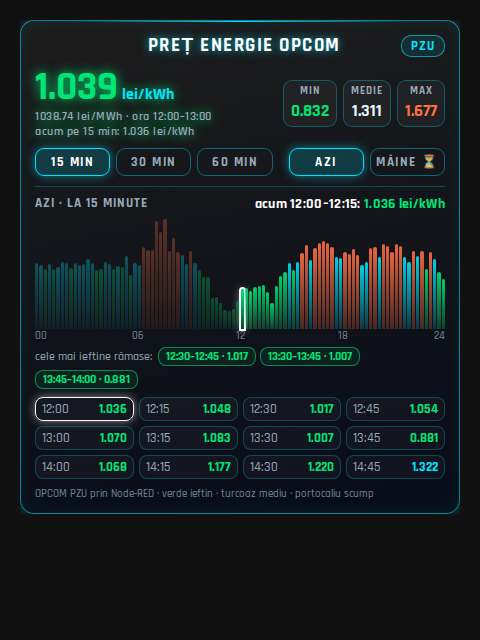

# Prețuri energie OPCOM (PZU) în Home Assistant

Flux **Node-RED** care descarcă prețurile pieței pentru ziua următoare (PZU) de pe [opcom.ro](https://www.opcom.ro) și le trimite în **Home Assistant**. Repo-ul include și un **card** pentru dashboard.



- prețuri pe **15, 30 și 60 de minute**, pentru **azi** și **mâine** (mâine: după ce le publică OPCOM, în jur de 13:00–14:30);
- prețul pe ora curentă (ca pe opcom.ro la „60min”) și pe intervalul de 15 min, plus min / medie / max;
- grafic colorat: verde = ieftin, turcoaz = mediu, portocaliu = scump (treimi ale zilei); cele mai ieftine intervale rămase.

Node-RED poate rula oriunde: pe calculator, pe un Raspberry Pi sau ca add-on. Fluxul folosește **doar nodurile de bază** din Node-RED, fără pachete suplimentare și fără MQTT.

## Fișiere

| Fișier | Ce este |
|---|---|
| `flows/opcom-home-assistant.json` | fluxul Node-RED (Meniu → Import) |
| `card/card_opcom_preturi.yaml` | cardul pentru Home Assistant |
| `src/*.js`, `card/card_opcom.js`, `card/card_opcom.css`, `build.py` | sursele; `python3 build.py` reface fluxul și cardul |

## Instalare

### 1. Token Home Assistant
În HA: **Profil** (jos, stânga) → **Securitate** → **Long-lived access tokens** → **Creează token**. Copiază tokenul.

### 2. Node-RED
1. Meniu → **Import** → lipește conținutul din `flows/opcom-home-assistant.json` → **Import**.
2. Deschide nodul **„Publică în HA”** și completează primele rânduri:
   ```js
   const HA_URL   = "http://192.168.1.10:8123";   // adresa ta de Home Assistant
   const HA_TOKEN = "eyJhbGciOi...";              // tokenul de la pasul 1
   ```
3. **Deploy**. După ~20 de secunde, sub noduri trebuie să apară:
   - „Salvează prețuri”: `AAAA-LL-ZZ: 96 intervale, …`;
   - „Rezultat HA”: verde **`HA OK la …`**.

   Dacă vezi roșu `401`, tokenul e greșit. Altă eroare înseamnă că adresa HA e greșită sau HA nu răspunde.

### 3. Cardul
1. Instalează **[button-card](https://github.com/custom-cards/button-card)** (HACS → Frontend → „button-card”).
2. Dashboard → Edit → **Add card** → **Manual** → lipește conținutul din `card/card_opcom_preturi.yaml` → Save.

Fontul [Rajdhani](https://fonts.google.com/specimen/Rajdhani) e opțional; fără el cardul folosește fontul implicit.

## Senzorul din Home Assistant

`sensor.opcom_pret_acum`: starea este prețul pe intervalul curent de 15 min (lei/MWh). Atribute:

| Atribut | Conținut |
|---|---|
| `azi_15`, `azi_30`, `azi_60` | prețurile de azi pe 15 min (96 valori) și mediile pe 30 min (48) și 60 min (24), în ordinea zilei |
| `maine_15`, `maine_30`, `maine_60` | la fel pentru mâine (goale până le publică OPCOM) |
| `azi`, `maine` | `{min, max, medie}` pe 15 min |
| `maine_disponibil` | `true` când există prețuri pentru mâine |
| `interval`, `data_azi`, `data_maine` | intervalul curent (1–96) și datele |

Senzorul e creat prin API-ul REST al HA (`POST /api/states/sensor.opcom_pret_acum`), la fiecare minut. Nu poate fi editat din interfață (nu are `unique_id`). După un restart HA lipsește cel mult un minut. Istoricul se păstrează normal.

## Note

- OPCOM e întrebat doar când lipsesc prețurile: la pornire, apoi la 10 minute pentru ziua de mâine, după ora 13. Prețurile se țin în memoria fluxului; după un restart Node-RED se descarcă din nou.
- Orele sunt în ora României (`Europe/Bucharest`); intervalul OPCOM 1 = 00:00–00:15.
- Datele vin de la OPCOM S.A.; acest proiect nu este afiliat cu OPCOM.
